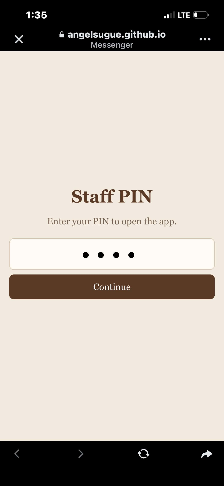
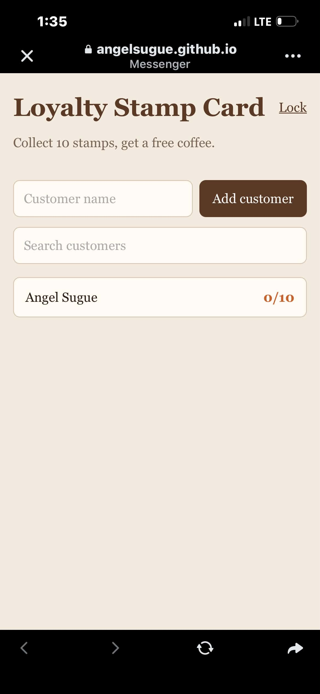
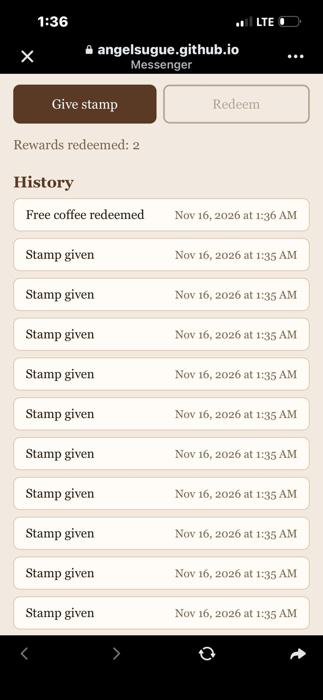

Loyalty Stamp Card

A mobile-friendly web app for coffee shops. Give and count stamps per customer.
After 10 stamps, the customer earns a free coffee.

## Features
- Add customers and search them by name
- Give a stamp (one tap) and see the count on a 10-circle card
- Reward notice at 10 stamps, with a Redeem button that resets the card
- Confetti when a card is full
- Stamp history: date and time of every stamp and redemption
- Staff PIN: the first launch asks you to set a 4-digit PIN; it is required to open the app, and a Lock button re-locks it
- Data is saved in the browser (localStorage), so it stays after closing

The PIN is a simple demo lock stored in the browser. A real app would check it on a server.

## Tech
HTML, CSS, and JavaScript. No libraries.

## Run it
Open index.html in a browser, or visit the live page: https://angelsugue.github.io/Loyalty-Stamp-Card/

## Files
- index.html: page structure
- style.css: styling
- script.js: stamp logic and saving

## Screenshots

## Author
Angel Faye Q. Sugue, BSINTE-2B
