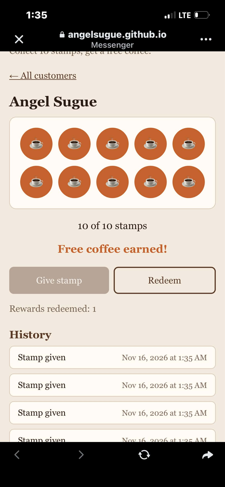

 Loyalty Stamp Card

A mobile-friendly web app for coffee shops. Staff give stamps to customers and count them per customer. At 10 stamps, the customer earns a free coffee.

## Features
- Add customers and search by name
- Give a stamp with one tap, shown on a 10-circle card
- Confetti and a "Free coffee earned!" notice at 10 stamps
- Redeem button that resets the card
- History of every stamp and redemption with date and time
- Staff PIN lock
- Data saved in the browser (localStorage)

## How to install and run
No installation needed.
1. Open the live app: https://angelsugue.github.io/Loyalty-Stamp-Card/
2. Or download this repo, then open index.html in a browser (Chrome, Edge, or Safari).
3. On first launch, set a 4-digit staff PIN. Then add a customer and give stamps.

## Built with
HTML, CSS, and JavaScript.

## Screenshots

## Author
Angel Faye Q. Sugue, BSINTE-2C
